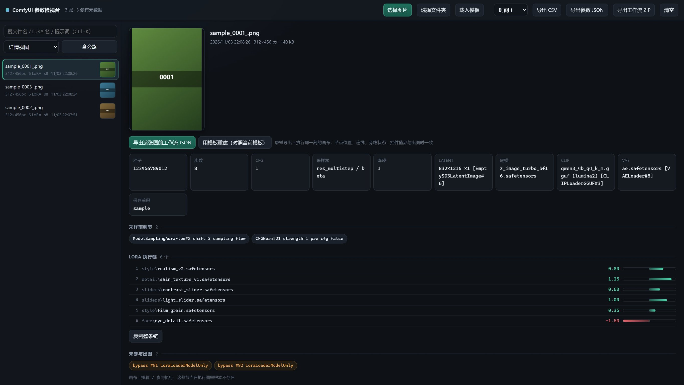

**English** ｜ [简体中文](README.zh-CN.md)

# ComfyUI Params Inspector

Drop a ComfyUI `output` folder into the browser and see **how each image was actually made**: the LoRA execution chain with every strength value, sampler settings, base model / CLIP / VAE, positive & negative prompts — plus the nodes sitting on your canvas that never took part in the render.

Runs entirely client-side: no build step, no dependencies, no uploads. Your PNGs never leave your machine.



> Every filename, model name, LoRA name and prompt in the screenshot is synthetic demo data, unrelated to any real asset. The UI itself is in Simplified Chinese.

## The problem

ComfyUI writes two JSON blobs into every PNG's `tEXt` chunk: `prompt` (the API graph submitted to the server) and `workflow` (the canvas graph). The catch:

- The canvas doesn't tell you what **this particular image** used — sliders get dragged, LoRAs get bypassed, prompts get rewritten inside custom nodes. Neither the filename nor the thumbnail says a word.
- Reading `CLIPTextEncode.text` directly usually gives you an empty string, because the prompt arrives over a **link** (e.g. the output of `ZhPromptEnhance`).
- A LoRA sitting on the canvas is not a LoRA that ran — nodes with `mode: 4` are absent from the execution graph entirely.
- Reproducing an old image means remembering every node by hand.

This tool flattens all of that into one view.

## Features

- **Browse**: pick a folder (recursive) / drop a folder / drop single PNGs. The list shows inline thumbnails; the detail pane shows a 212px preview that opens full-size on click.
- **Parameters**: seed, steps, CFG, sampler / scheduler, denoise, latent size, base model, CLIP (with type), VAE, save prefix, and pre-sampler patches (`ModelSamplingAuraFlow`, `CFGNorm`, …).
- **LoRA execution chain**: walks back from `KSampler.model` and lists every LoRA in true execution order with its strength, drawn as a zero-centred slider (green positive / red negative).
- **Bypass detection**: reads `mode: 4` / `mode: 2` from the canvas graph and flags whatever was on screen but not in the run.
- **Prompts**: follows links to the real source and annotates both the node and the slot, e.g.
  `CLIPTextEncode#4.text[slot 0] ← ZhPromptEnhance#79.text[slot 0]`.
  Non-zero slots of multi-output nodes (such as enhancer-generated negatives) are marked "generated at runtime" instead of being passed off as a fixed value.
- **Search**: filename / LoRA name / prompt body. `Ctrl+K` to focus, `↑` `↓` to move between images.
- **Export**: parameter table as CSV (UTF-8 BOM, opens cleanly in Excel) and as JSON.
- **Workflow export**: writes the PNG's `workflow` chunk back out as an importable `.workflow.json`, or batches everything into a zip.
- **Template rebuild**: take one of your existing workflows as a template and pour the parsed parameters (including the whole LoRA chain) into it, producing a **new** workflow JSON. The template is deep-cloned and never written back.

## Quick start

```bash
git clone https://github.com/<you>/comfy-png-inspector.git
cd comfy-png-inspector
```

Open `index.html` (Chrome / Edge 103+, `DecompressionStream` required), then drag your ComfyUI `output` folder into the window.

You can also enable GitHub Pages for the repo and use it online — it is pure static, no server needed.

### Exporting workflows / rebuilding from a template

1. Click **载入模板** (load template) in the top bar and pick a canvas workflow JSON (`ComfyUI/user/default/workflows/*.json`).
2. Select an image:
   - PNG contains a `workflow` chunk → **导出这张图的工作流 JSON** gives you the exact canvas from the moment of generation;
   - API graph only → **用模板重建并导出** writes `<image>.rebuilt.json` and shows an itemised change list.
3. **导出工作流 ZIP** packs every filtered image that carries a `workflow` chunk.

Rebuilding replaces base model / CLIP / VAE / latent size / `SaveImage` prefix / prompt / KSampler fields, and **rebuilds the entire LoRA chain in parsed order**, rewiring its tail into the consumer node the template originally used.

## CLI

For when you don't want a browser:

```bash
python cli/comfy_png_parse.py ./output --no-text
python cli/comfy_png_parse.py ./output --csv index.csv --json index.json
python cli/comfy_png_parse.py a.png --full     # full prompt text
```

Standard library only. Same output as the web UI.

## DeepSeek Harness plugin

This repository is also a DSH bundle (`dsh.bundle` is declared in `package.json`). Installed into the Harness it adds one model-facing tool:

```
comfy_png_inspect(path, limit?, include_prompt?)
```

Point it at a PNG or at a ComfyUI `output` directory and it reports, per image, the LoRA execution chain with strengths, sampler settings, base model / CLIP / VAE, latent size, prompts, and any bypassed canvas nodes. Parsing is shared with the web UI through `comfy-png-core.js` — there is no second implementation.

```bash
dsh plugin add https://github.com/zzcyydshhh/comfy-png-inspector
```

The tool lives in `lib/index.js`; the plugin row is declared by `cordis.patch.yml`.

## How it works

1. **PNG chunk parsing**: reads `tEXt` / `zTXt` / `iTXt`; `zTXt` and compressed `iTXt` are inflated with `DecompressionStream('deflate')` (zlib stream).
2. **Chain tracing**: start at `KSampler.model` and follow `inputs.model` backwards. Node class decides the bucket (`LoraLoader*` = slider, `CFGNorm` / `ModelSampling*` = pre-sampler patch). Stops at `UNETLoader` / `CheckpointLoaderSimple`, then reverses into execution order.
3. **Bypass detection**: purely from `workflow.nodes[].mode` — `4` = bypass, `2` = mute. These nodes are absent from the API graph, which is exactly why "on canvas" ≠ "in the run".
4. **Prompt resolution**: a string `text` is used as-is; a `[node_id, slot]` ref walks the link to its source. A slot ≠ 0 means the value is produced by that node at runtime, so it is not treated as a literal.
5. **Template rebuild**: deep-clone the template → strip its LoRA nodes and their links → append new nodes in parsed order and chain them → rewire the tail into the original consumer → self-check (endpoint existence, self-links, KSampler wiring, LoRA count).

## Known limitations

- PNG only. ComfyUI metadata lives in PNG chunks; jpg / webp have none.
- Re-saving through a screenshot tool, an IM app, or Photoshop drops the `tEXt` chunk — the UI will say "no ComfyUI metadata".
- Under `file://` the browser will not let JavaScript scan a directory, so you must pick or drop once per session.
- Rebuild is bounded by **the node classes present in the template**: a node class that exists in the PNG but not in the template will not be invented (LoRA nodes are the exception — they are recreated from the parsed count). Read the change list before exporting.
- The zip writer is store-only (no compression) to stay dependency-free; a few hundred workflows land in the low tens of MB.

## Layout

```
index.html              single-page app (UI + interaction)
comfy-png-core.js       parsing & rebuild core, works in browser and Node (UMD-ish)
cli/comfy_png_parse.py  CLI equivalent, standard library only
```

## License

MIT
