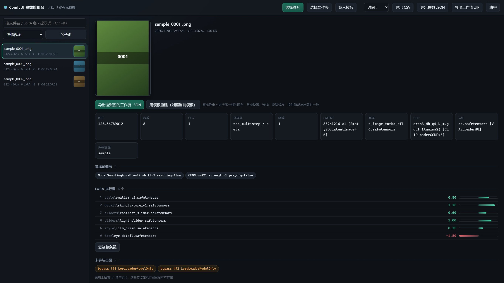

[English](README.md) ｜ **简体中文**

# ComfyUI 参数检视台

把一个 ComfyUI 的 `output` 文件夹拖进浏览器，逐张看清**这张图是怎么生成的**：LoRA 执行链和每一档强度、采样参数、底模 / CLIP / VAE、正向反向提示词，以及画布上摆着却根本没参与出图的旁路节点。

纯前端、零依赖、零上传——PNG 不出本机，没有任何网络请求。



> 截图中的文件名、模型名、LoRA 名与提示词全部是合成的示例数据，不对应任何真实素材。

## 解决的问题

ComfyUI 把两份 JSON 写进 PNG 的 `tEXt` 块：`prompt`（提交给服务端的 API 图）和 `workflow`（画布图）。问题在于：

- 画布上看不出**这一张**到底用了什么——滑块被人拖过、LoRA 被 bypass、提示词在自定义节点里被改写，文件名和缩略图都不会告诉你。
- 直接读 `CLIPTextEncode` 的 `text` 常常是空串，因为提示词是**用连线**接进来的（例如 `ZhPromptEnhance` 的输出）。
- 画布上摆着的 LoRA 不等于参与执行——`mode: 4` 的节点在执行图里根本不存在。
- 想复现一张老图，得逐个节点回忆参数。

这个工具把上面这些都摊平成一张表。

## 功能

- **浏览**：选择文件夹（递归）/ 拖入文件夹 / 拖入单张 PNG；左侧列表带行内缩略图，右侧详情 212px 预览可点击放大。
- **参数**：种子、步数、CFG、采样器 / 调度器、降噪、latent 尺寸、底模、CLIP（含类型）、VAE、保存前缀、采样前调节（`ModelSamplingAuraFlow` / `CFGNorm` 等）。
- **LoRA 执行链**：从 `KSampler.model` 输入往回爬，按真实执行顺序列出每个 LoRA 与强度，并画成以 0 为基准的滑块（正绿负红）。
- **旁路识别**：读出画布图里的 `mode: 4` / `mode: 2` 节点，标出「摆着但没参与」。
- **提示词**：顺着连线找到真正的源头，并注明来源与槽位，例如
  `CLIPTextEncode#4.text[slot 0] ← ZhPromptEnhance#79.text[slot 0]`。
  多输出节点的非 0 槽位（如增强器生成的反向词）标记为「运行时生成」，不会当成定值骗你。
- **搜索**：文件名 / LoRA 名 / 提示词正文，`Ctrl+K` 聚焦，`↑` `↓` 切图。
- **导出**：参数表 CSV（带 BOM，Excel 直接开）、参数 JSON。
- **工作流导出**：把 PNG 里的 `workflow` 块原样导出成可导入 ComfyUI 的 `.workflow.json`；批量打包成 zip。
- **模板重建**：用一份现有工作流当模板，把解析出的参数（含整条 LoRA 链）套进去，生成一份**新**工作流 JSON。模板只读深拷贝，绝不回写。

## 快速开始

```bash
git clone https://github.com/<you>/comfy-png-inspector.git
cd comfy-png-inspector
```

双击 `index.html`（Chrome / Edge 103+，需要 `DecompressionStream`），然后把 ComfyUI 的 `output` 文件夹拖进窗口。

也可以在仓库 Pages 里直接开（纯静态，无需服务端）。

### 导出工作流 / 模板重建

1. 点顶栏「载入模板」，选一份画布工作流 JSON（`ComfyUI/user/default/workflows/*.json`）。
2. 选中一张图：
   - PNG 带 `workflow` 块 → 点「导出这张图的工作流 JSON」，得到与出图那一刻完全一致的画布；
   - 只有 API 图 → 点「用模板重建并导出」，得到 `<图名>.rebuilt.json`，并显示逐项变更清单。
3. 顶栏「导出工作流 ZIP」把当前筛选结果里所有带 `workflow` 块的图批量打包。

重建会：替换底模 / CLIP / VAE / latent 宽高 / `SaveImage` 前缀 / 提示词 / KSampler 各项，并**按解析出的顺序重建整条 LoRA 链**，末尾接回模板里原本的消费者节点。

## 命令行版

不想开浏览器时：

```bash
python cli/comfy_png_parse.py ./output --no-text
python cli/comfy_png_parse.py ./output --csv index.csv --json index.json
python cli/comfy_png_parse.py a.png --full     # 提示词全文
```

只依赖 Python 标准库。输出与网页版一致。

## 原理笔记

1. **PNG 块解析**：读 `tEXt` / `zTXt` / `iTXt`，`zTXt` 与压缩 `iTXt` 用 `DecompressionStream('deflate')`（zlib 流）解压。
2. **执行链回溯**：`KSampler.model` → 逐层 `inputs.model` 往回走，节点类型决定归类（`LoraLoader*` = 滑块，`CFGNorm` / `ModelSampling*` = 采样前调节）。到 `UNETLoader` / `CheckpointLoaderSimple` 停，最后反转成执行顺序。
3. **旁路判定**：只看 `workflow.nodes[].mode`，`4` = bypass、`2` = mute；API 图里没有它们，这正是「摆着不等于生效」。
4. **提示词解析**：`text` 是字符串就直接用；是 `[节点id, 槽位]` 就顺着连线走到源头。槽位 ≠ 0 视为该节点运行时生成的输出，不当定值。
5. **模板重组**：深拷贝模板 → 摘掉原有 LoRA 节点与连线 → 按解析顺序新建节点串成链 → 接回原消费者 → 自检（端点存在性、自连、KSampler 接线、LoRA 数量）。

## 已知限制

- 只认 PNG。ComfyUI 的元数据只写在 PNG 里，jpg / webp 没有。
- 图片被截图工具、微信、PS 等重新保存过会丢 `tEXt`，界面会标「没有 ComfyUI 元数据」。
- `file://` 下浏览器不允许 JS 自己扫目录，必须手动选或拖一次。
- 重建以**模板的节点类**为准：PNG 里有、模板里没有的普通节点不会凭空生成（LoRA 节点例外，会按数量重建）。导出前看一眼变更清单即可。
- zip 打包是 store 模式（不压缩），换来零依赖；几百张工作流大概十几 MB。

## 目录

```
index.html            单页应用（UI + 交互）
comfy-png-core.js     解析与重组核心，浏览器 / Node 通用（UMD 风格）
cli/comfy_png_parse.py  命令行等价物，纯标准库
```

## License

MIT
