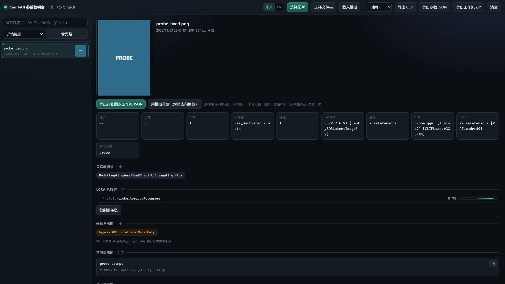

[English](README.md) ｜ **简体中文**

# ComfyUI 参数检视台

**一张图，就是一份完整配方。** 把 ComfyUI 生成的 PNG 拖进来，直接得到产出它的工作流、整条 LoRA 链和全部采样参数——能原样导出、也能按参数在你自己的模板上重建。

单页应用，双击 `index.html` 就能用。零依赖、零上传：图片不出你的机器，没有任何网络请求。



> 截图中的文件名、模型名、LoRA 名与提示词全部是合成的示例数据，不对应任何真实素材。

---

## 三十秒看懂它在干什么

| 你想做的事 | 它怎么给 |
|---|---|
| 「这张图当初怎么生成的？」 | 拖进 PNG（或整个 `output` 文件夹）→ 每条都在眼前：LoRA 顺序与强度、种子/步数/CFG/采样器、底模、CLIP、VAE、正反向提示词 |
| 「我要把这次的效果再做一遍」 | 点**导出这张图的工作流 JSON** → 得到一个 `.workflow.json`，拖回 ComfyUI 画布就能跑 |
| 「图上没有工作流块，只有参数」 | 点**载入模板**选你现在的常用工作流 → 点**用模板重建** → 参数（含整条 LoRA 链）全部套进去，导出一份新工作流 |
| 「我要查一堆老图的参数」 | 导出 CSV / JSON，或顶栏**导出工作流 ZIP** 批量打包 |

---

## 它解决的是四件「你以为你看得见，其实看不见」的事

1. **画布上摆着 ≠ 真的跑了。** 演示图里 `#91`、`#92` 两个 LoRA 就摆在那儿，但它们是 `mode: 4`（旁路），执行图里根本不存在。工具会单独把它们列出来，标明「摆着但没参与」。
2. **提示词直接读是空的。** `CLIPTextEncode.text` 经常是空串，因为文本是从别的节点**连线**过来的（比如 `ZhPromptEnhance` 的输出）。工具顺着连线走到源头，并注明来源：`CLIPTextEncode#4.text[slot 0] ← ZhPromptEnhance#79.text[slot 0]`。
3. **反向词可能是运行时算出来的。** 增强器的槽位 1 是它现场生成的，PNG 里没存定值。工具标「运行时生成」，而不是拿它的输入冒充结果。
4. **参数散落在几十个节点里。** 17 个 LoRA 串成一条链，谁在谁后面、各是几档——工具从 `KSampler.model` 一路往回爬，按真实执行顺序排给你看。

---

## 功能

- **浏览**：选文件夹（递归）/ 拖文件夹 / 拖单张；列表行内带缩略图，详情页 212px 预览可点击放大。
- **参数**：种子、步数、CFG、采样器 / 调度器、降噪、latent、底模、CLIP（含类型）、VAE、保存前缀、采样前调节（`ModelSamplingAuraFlow`、`CFGNorm` …）。
- **LoRA 执行链**：按执行顺序 + 强度，画成以 0 为基准的滑块（正绿负红），可一键复制整条链。
- **提示词**：连线溯源 + 槽位标注，正文可展开、可复制。
- **搜索**：文件名 / LoRA 名 / 提示词正文，`Ctrl+K` 聚焦，`↑` `↓` 切图。
- **导出**：参数表 CSV（带 BOM，Excel 直接开）、参数 JSON。
- **工作流导出**：原样导出 `.workflow.json`；或整批打包成 zip。
- **模板重建**：用现有工作流当模板套参数，产出新工作流；模板只读深拷贝，绝不回写。
- **DSH 插件**：同一套解析逻辑也做成 DeepSeek Harness 组合包，模型可直接调用 `comfy_png_inspect`。

---

## 快速开始

```bash
git clone https://github.com/zzcyydshhh/comfy-png-inspector.git
cd comfy-png-inspector
```

双击 **`comfy-png-inspector.html`**（Chrome / Edge 103+，需要 `DecompressionStream`），把 ComfyUI 的 `output` 文件夹拖进窗口。

- 根目录的 `index.html` 只是一行跳转，为 GitHub Pages 存在；离线双击它也会自动进主文件。
- 界面**中英双语**：右上角 `中文 / EN` 一键切换，会记住你的选择；默认跟随浏览器语言。
- 想直接用英文版网址：`comfy-png-inspector.html?lang=en`（中文用 `?lang=zh`）。

---

## 复现工作流：两种模式，别搞混

选中一张图后，详情页顶部有两个按钮，区别在**数据够不够**：

| | 原样导出 | 用模板重建 |
|---|---|---|
| 按钮 | 导出这张图的工作流 JSON | 用模板重建并导出 |
| 前提 | PNG 里带 `workflow` 块 | 先载入任意一份画布工作流当模板 |
| 结果 | 出图那一刻的画布，节点位置/连线/旁路状态完全一致 | 以模板的节点布局为准，把参数灌进去 |
| 适合 | 直接复现，最可靠 | 图只有 API 图；或想套回自己现在的模板体系 |

重建会替换：底模 / CLIP / VAE / latent 宽高 / `SaveImage` 前缀 / 提示词 / KSampler 各项，并**按解析出的顺序重建整条 LoRA 链**，把链尾接回模板原本的消费者节点（例如 `ModelSamplingAuraFlow` 的 `model` 输入）。导出前会列一份逐项变更清单，最后跑自检：连线端点是否存在、有无自连、KSampler 接线是否完整。

---

## 命令行版

不想开浏览器时：

```bash
python cli/comfy_png_parse.py ./output --no-text
python cli/comfy_png_parse.py ./output --csv index.csv --json index.json
python cli/comfy_png_parse.py a.png --full     # 打印提示词全文
```

纯标准库，输出与网页版一致。

---

## DeepSeek Harness 插件

仓库同时是一个 DSH 组合包（`package.json` 里的 `dsh.bundle`）。装进 Harness 后，模型多一个工具：

```
comfy_png_inspect(path, limit?, include_prompt?)
```

传一个 PNG 或一个 `output` 目录，返回每张图的 LoRA 链、采样参数、底模 / CLIP / VAE、latent、提示词与旁路节点。解析逻辑与网页版共用 `comfy-png-core.js`，没有第二份实现。

```bash
dsh plugin add https://github.com/zzcyydshhh/comfy-png-inspector
```

---

## 原理笔记

1. **PNG 块解析**：读 `tEXt` / `zTXt` / `iTXt`；`zTXt` 与压缩 `iTXt` 用 `DecompressionStream('deflate')`（zlib 流）解压。
2. **执行链回溯**：从 `KSampler.model` 沿 `inputs.model` 往回走，按节点类型归类（`LoraLoader*` = 滑块，`CFGNorm` / `ModelSampling*` = 采样前调节），到 `UNETLoader` / `CheckpointLoaderSimple` 停，最后反转成执行顺序。
3. **旁路判定**：只看 `workflow.nodes[].mode`，`4` = bypass、`2` = mute。它们不在 API 图里，这正是「摆着不等于生效」。
4. **提示词解析**：`text` 是字符串直接用；是 `[节点id, 槽位]` 就顺着连线找源头；槽位 ≠ 0 视为运行时生成，不当定值。
5. **模板重组**：深拷贝模板 → 摘掉原有 LoRA 节点与连线 → 按解析顺序新建节点串成链 → 接回原消费者 → 自检。

---

## 已知限制

- 只认 PNG。ComfyUI 的元数据只写在 PNG 里，jpg / webp 没有。
- 图片被截图工具、微信、PS 等重新保存过会丢 `tEXt`，界面会标「没有 ComfyUI 元数据」。
- `file://` 下浏览器不允许 JS 自己扫目录，必须手动选或拖一次。
- 重建以**模板的节点类**为准：PNG 里有、模板里没有的普通节点不会凭空生成（LoRA 节点例外，会按数量重建）。导出前看一眼变更清单即可。
- zip 打包是 store 模式（不压缩），换来零依赖；几百份工作流大概十几 MB。

---

## 目录

```
comfy-png-inspector.html  单页应用（UI + 交互，中英双语）
index.html                跳转页，只为 GitHub Pages 的根路径
comfy-png-core.js         解析与重组核心，浏览器 / Node 通用
lib/index.js            DSH 插件：comfy_png_inspect 工具
cordis.patch.yml        DSH 组合包的插件行声明
cli/comfy_png_parse.py  命令行等价物，纯标准库
```

## License

MIT
